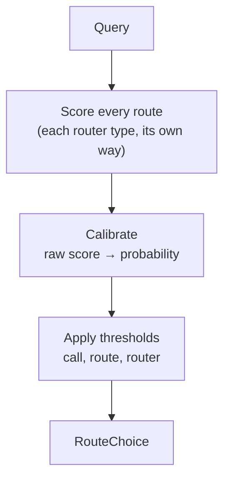
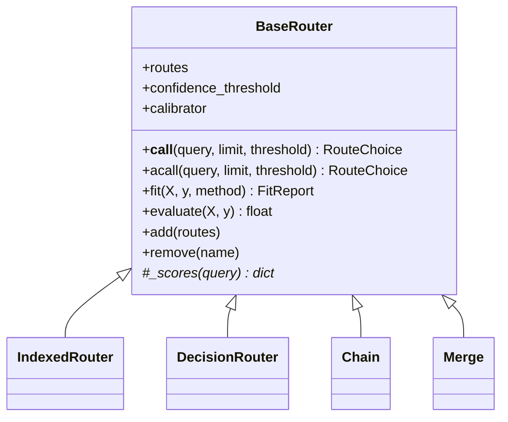
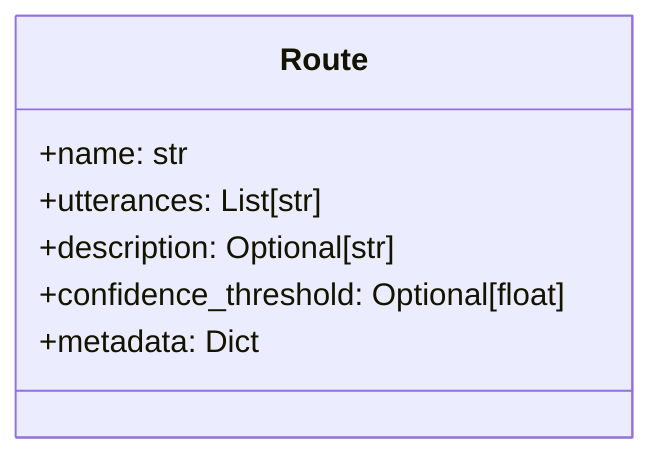
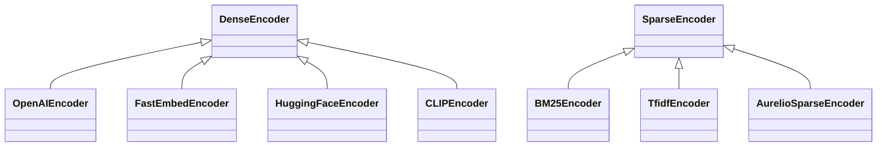
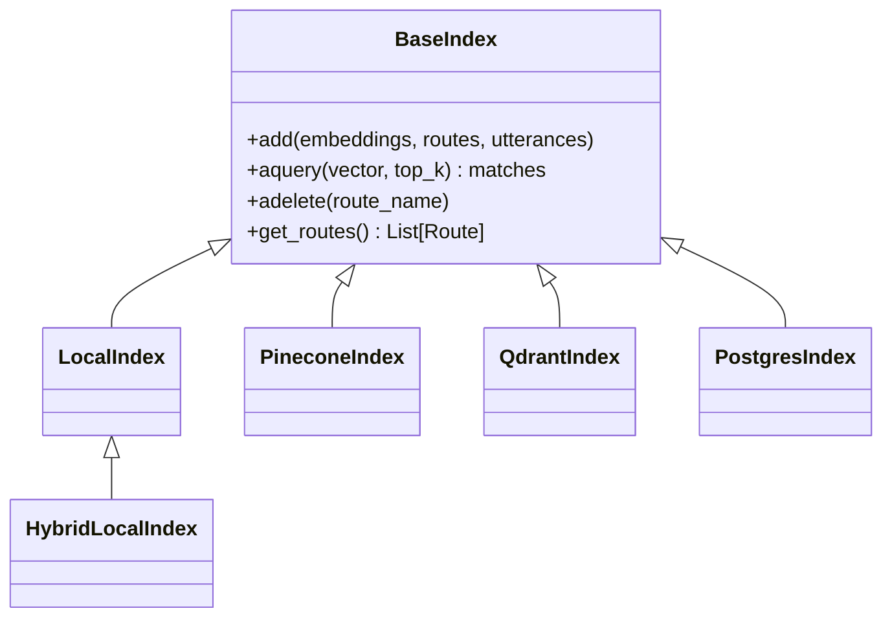
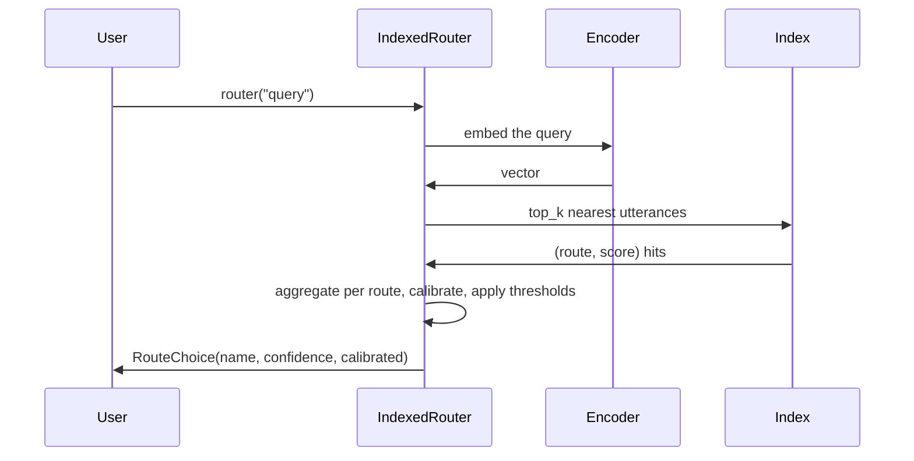
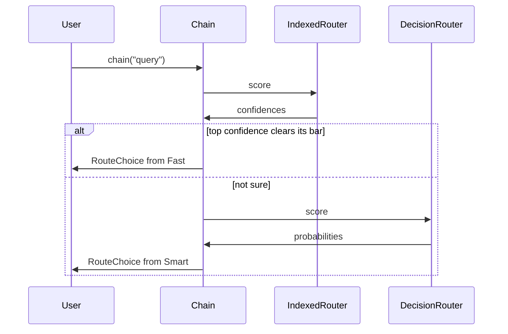

## System overview

Every router does one thing: given a query, it scores every route. Everything after that is shared. The base class turns the scores into confidences (calibrated, if you've fitted it), applies the thresholds, and hands back a `RouteChoice`.

Routers differ only in how they score:

- **`IndexedRouter`** scores by embedding similarity: an encoder plus an index.
- **`DecisionRouter`** scores by asking a decision model, with one HTTP call.
- **`Chain`** and **`Merge`** score by asking other routers.

A router of your own is one more subclass: implement `_scores` and the rest comes free. See [routers](../components/routers#build-your-own-router).

## Core components

### Routes

A route is one decision a router can make. The same `Route` works with every router type.

`IndexedRouter` embeds the `utterances`; `DecisionRouter` reads the `description`. See [routes](../components/routes).

### Encoders

Encoders map inputs into semantic space. `IndexedRouter` uses them; `DecisionRouter` doesn't.

- **Dense encoders** produce continuous vectors (OpenAI, FastEmbed, Hugging Face, ...).
- **Sparse encoders** produce mostly-zero vectors keyed on terms (BM25, TF-IDF, ...). Add one to an `IndexedRouter` for hybrid search.
- **Asymmetric encoders** embed queries and documents differently; the router calls the right side for each.

See [encoders](../components/encoders).

### Indexes

Indexes store utterance vectors and search them. The index is the single source of truth for an `IndexedRouter`'s routes: building a router writes to it, and `router.routes` is a cached view of it, which `refresh()` re-reads.

See [indexes](../components/indexes).

### Calibrator

A `Calibrator` maps a raw score to the probability that the top route is right. `fit()` builds one from labelled queries, with Platt scaling or isotonic regression. Both are monotone, so calibration never changes which route ranks first, only the number attached to it. See [calibration](../features/calibration).

## Data flow

An `IndexedRouter` call:

A `Chain` of an `IndexedRouter` and a `DecisionRouter`:

## Sync and async

The router logic is async all the way down. Every sync method (`__call__`, `fit`, `add`, ...) runs its async twin on one background event loop that all routers share. That keeps HTTP connections pooled between calls, so repeated calls to a remote encoder, index or decision model don't pay to reconnect. It also means sync calls work inside notebooks, which already run a loop.

In async code, use the `a`-methods with `await`.

## Performance notes

- **Encoding dominates.** For an `IndexedRouter`, nearly all of a call's time is embedding the query. A local encoder or a fast embedding API matters more than the index.
- **Batch where you can.** `fit()` and `evaluate()` embed all their queries in one encoder call.
- **A Chain pays only when it must.** Confident queries stop at the first router; only ambiguous ones pay for the decision model too.
- **Warm up remote models.** The first call to a decision model can be much slower than the rest. Make one call at startup.
